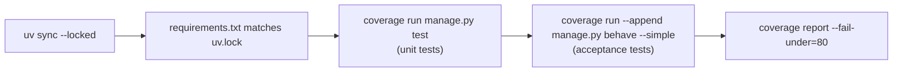
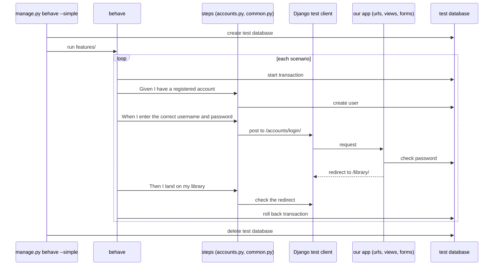
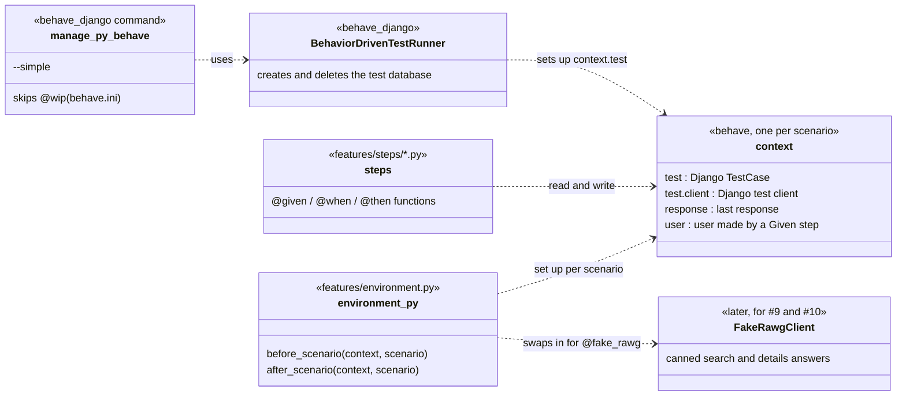

# Design: Behave acceptance tests

**Status: agreed.** This is the plan for #29. Sprint 1 requires behavior-driven development with Behave, and every story already has Gherkin acceptance criteria. This page covers how those criteria become tests that run locally and in CI.

## Sprint 1 scope
Set up Behave, turn the acceptance criteria for accounts (#7 sign-up, #8 log in and out) into `.feature` files that pass, and run them in CI. Search (#9) and game details (#10) get feature files when their code lands. They're in this document only to check that the setup works for code that calls RAWG.

## Decisions
| # | Decision | Status |
| --- | --- | --- |
| 1 | Use `behave-django`, not plain `behave` | Agreed |
| 2 | Steps use Django's test client (`--simple`), not a real browser | Agreed |
| 3 | Feature files live in `binge_and_bosses/features/`, one per story | Agreed |
| 4 | Steps are grouped by area, not by feature | Agreed |
| 5 | `behave_django` is added to `INSTALLED_APPS` only when it's installed | Agreed |
| 6 | CI runs Behave after the unit tests, and both count toward the 80% coverage check | Agreed |
| 7 | Scenarios never call RAWG; steps swap in fake RAWG answers | Agreed |
| 8 | Scenarios the app doesn't meet yet are tagged `@wip`, linked to an issue, and skipped in CI | Agreed |
| 9 | Each new feature's PR includes its feature file, as part of its tests | Agreed |

### 1. `behave-django` instead of plain `behave`
Plain Behave doesn't know about Django. We would have to set up Django, create a test database and clean it up between scenarios ourselves. [`behave-django`](https://behave-django.readthedocs.io/) does all of that and adds a `manage.py behave` command. Like `manage.py test`, it:
- creates a temporary test database and deletes it afterward, so `db.sqlite3` is never touched
- runs each scenario inside a database transaction and rolls it back, so scenarios can't affect each other
- gives every step Django's test client and assertions through `context.test`

Its latest version (2.0.0) officially lists Django up to 6.0, and we're on 6.1.2. We tried it on a copy of the project: a login scenario passed in both modes (decision 2), and coverage counted the code it ran.

### 2. Test client, not a browser
`manage.py behave --simple` runs scenarios with Django's test client. The client sends requests straight to our views and reads the HTML that comes back, with no server and no browser. That's fast, needs nothing extra in CI, and is how our unit tests already work.

A browser (Playwright or Selenium) is only needed to test JavaScript running in the page, and we have none yet. If we add some, we drop `--simple` (behave-django then starts a live server at `context.base_url`) and add a browser to the scenarios that need one. The feature files don't change.

### 3. One feature file per story
Each story's Gherkin becomes `features/<story>.feature`, copied from the issue. The feature file becomes the version we keep up to date: if acceptance criteria change, update the issue and the feature file in the same PR.

```
binge_and_bosses/
  manage.py
  behave.ini                # skips @wip scenarios by default
  features/
    environment.py          # hooks shared by all scenarios (added with search, for fake RAWG)
    user_registration.feature   # #7
    user_authentication.feature # #8
    search_by_title.feature     # #9, when search lands
    game_details.feature        # #10, when details land
    steps/
      common.py             # "I see ...", "I am logged in", page visits
      accounts.py           # sign-up and log-in steps
      games.py              # search and details steps, later
```

Django's `manage.py test` only collects files named `test*.py`, so it won't try to run the step files.

### 4. Steps grouped by area
Behave matches each step's text against every step function, whichever file it's in. Steps like `Then I see "..."` are used by many features, so they go in `common.py` once. Feature-specific steps go in the file for their area (`accounts.py`, `games.py`). Two step functions with the same text cause an error, so check `common.py` before adding a step.

### 5. `behave_django` only where it's installed
`behave-django` is a dev dependency (`uv add --dev behave-django`), so Render doesn't install it: it installs from `requirements.txt`, which leaves dev packages out. If `settings.py` always listed `behave_django` in `INSTALLED_APPS`, production would crash on startup. So `settings.py` adds it only when the package is installed:

```python
from importlib.util import find_spec

if find_spec("behave_django"):
    INSTALLED_APPS.append("behave_django")
```

### 6. CI and coverage
Behave runs as its own CI step after the unit tests. Both run under coverage, and the 80% check uses the combined result:



A failing scenario fails the build, the same as a failing unit test.

### 7. No real RAWG calls
Scenarios follow the same rule as the unit tests in the game catalog design (#56): CI never needs `RAWG_API_KEY` and never uses our request quota. Scenarios that search or open a game are tagged `@fake_rawg`. For those scenarios, a hook in `environment.py` swaps in a fake RAWG client and swaps the real one back afterward. Steps like `Given RAWG has a game called "Pokemon Red"` add to the fake's answers. (Ryan's search code patches `games.views.search_game` in its unit tests; the hook would patch the same place.)

### 8. Criteria the app doesn't meet yet
Writing the feature files shows where the app and the stories disagree. A scenario that can't pass yet is tagged `@wip`, gets a comment linking the issue that will fix it, and is skipped by default (`default_tags = not @wip` in `binge_and_bosses/behave.ini`; run them with `--tags=@wip`). That's better than leaving it out: the gap is visible in the file, and removing the tag is part of fixing the issue.

## How a scenario runs


## Code structure


## Sprint 1 scenarios
| Story | Scenario | Passes on `main` today? |
| --- | --- | --- |
| #7 Sign-up | Successful sign-up | Yes |
| #7 Sign-up | Email already registered | **No.** Emails aren't unique, so a second account with the same email is created. Tagged `@wip` until #62 (Sprint 2). |
| #7 Sign-up | Invalid email or weak password | Yes (Django's email check and 8-character minimum) |
| #8 Log in | Correct credentials | Yes |
| #8 Log in | Log out | Yes |
| #8 Log in | Wrong username or password | Yes (#61) |

#7 is closed, but its second scenario isn't met. It moved to #62 in Sprint 2, along with unique emails.

## What changes
- `pyproject.toml`, `uv.lock`: `behave-django` as a dev dependency. `requirements.txt` doesn't change, because it has no dev packages.
- `settings.py`: add `behave_django` when it's installed (decision 5).
- `binge_and_bosses/features/`: the two feature files, the steps, and `environment.py`.
- `.github/workflows/ci.yaml`: the Behave step and the `--append` coverage (decision 6).
- `README.md`: how to run the scenarios, how to add one, and an AI usage log row.

## Open questions
1. **Story wording (team):** #7 says "create an account with my email and a password", but sign-up also asks for a username. Update the story to match? Asked on Discord.

Settled:
- #7's duplicate-email scenario moved to #62 (Sprint 2).
- Feature files are written as part of each new feature's tests, in the same PR (decision 9).
