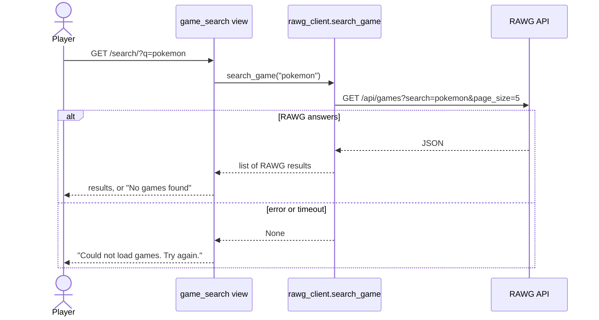
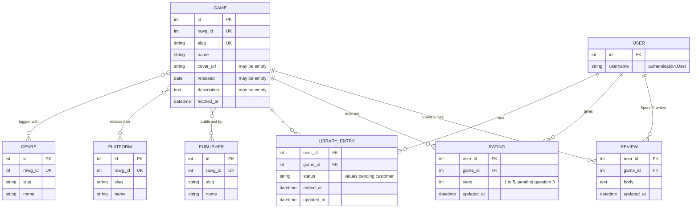
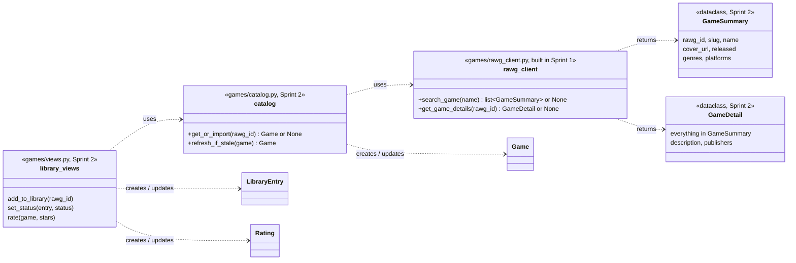
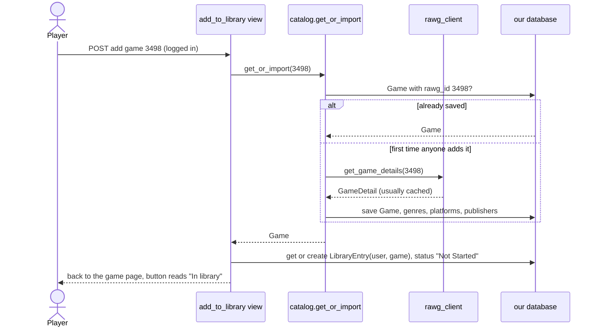

# Design: game catalog and library (Sprint 2)

**Status: proposal for Sprint 2.** Comment on the PR. Once the team agrees, this page is the reference for #11 (add to library), #12 (play status) and #13 (rating). It builds on the search and details pages Ryan built in Sprint 1 (#9, #10).

## Where we are after Sprint 1
Ryan built search and game details on `game-search-catalog-branch`:

- **`games/rawg_client.py`** is the only code that talks to [RAWG](https://rawg.io/apidocs), the free video game database we use. It has two functions:
  - `search_game(name)` returns RAWG's first 5 matches as RAWG's own JSON, or `None` if the request fails.
  - `get_game_details(game_id)` returns one game's JSON, or `None`.
  Both use `requests` with a 10-second timeout and our key from `settings.RAWG_API_KEY`.
- **Views and pages:** `/search/?q=…` shows results with cover art, or "No games found". `/<RAWG id>/` shows a game's cover, description, release date, genres and platforms, with placeholders when RAWG has none. Both pages show an error message if RAWG is down, and both link to RAWG as its terms require.
- **Tests** replace `requests.get` (for `rawg_client`) and the two functions (for the views) with fakes, so CI never calls RAWG. CI uses a dummy key.
- **Nothing is saved yet.** There's no cache, and the `Game` model is still the original sample-data one.

## Sprint 2 scope
- **Add to library (#11).** This is the first time a game gets saved to our database.
- **Play status (#12)** and **rating (#13)** for games in a user's library.
- **The catalog work those stories need:** caching RAWG responses, saving games with their genres, platforms and publishers, and replacing the sample `Game` model.
- **Behave feature files** for #9 and #10 (they don't have them yet) and #11–#13. These use fake RAWG answers, as described in `docs/design/behave.md` (#63).

Reviews (#14) are Sprint 3. They're in the data model below only to check that Sprint 2's tables won't need redoing.

## Decisions
| # | Decision | Status |
| --- | --- | --- |
| 1 | Use RAWG for game data | Agreed. Built. |
| 2 | Search RAWG live; don't copy their database | Agreed. Built. |
| 3 | Cache RAWG responses for a few hours | Agreed. Sprint 2. |
| 4 | Save a game to our database only when a user does something with it. Adding it to a library is the first such action. | Agreed. Sprint 2. |
| 5 | Genres, platforms and publishers get their own tables | Agreed. Sprint 2. |
| 6 | Ratings and reviews are separate | Agreed. Ratings in Sprint 2, reviews in Sprint 3. |
| 7 | One module talks to RAWG (`rawg_client.py`); another saves RAWG data in our database (`catalog.py`) | Agreed. `rawg_client.py` is built; `catalog.py` is Sprint 2. |
| 8 | Library statuses, and whether users can make their own lists | **Waiting on the customer** |
| 9 | Build on Ryan's `rawg_client.py` rather than replace it | **Proposed** |
| 10 | A saved game stores title, description, release date, publishers, genres, cover and platforms | Agreed. Sprint 2. |

### 2. Search live instead of copying RAWG
RAWG has close to a million games, and its free plan allows 20,000 requests a month. Copying the database would use most of a month's quota, would go out of date right away, and bulk downloads need a paid plan. So the server asks RAWG each time someone searches. The browser never talks to RAWG directly, so our API key stays on the server.

### 3. Cache responses
Popular searches ("zelda", "minecraft") would otherwise ask RAWG the same thing many times a day. Sprint 2 adds Django's built-in cache inside `rawg_client.py`: each search and each game's details are kept for a few hours, so repeats cost no requests. Failed requests aren't cached.

### 4. Save games only when a user touches them
A search result is shown and forgotten. When a user adds a game to their library (and later, rates or reviews it), `catalog.py` saves it in our `Game` table. Libraries, ratings and reviews point at our row, so they still work if RAWG is down. We save the cover image's URL, not the image.

Saved games can go stale (a new platform, a new cover). Each `Game` records when it was fetched (`fetched_at`), and the details page refreshes it from RAWG when it's old.

### 5. Genres, platforms and publishers get their own tables
A game can have several of each, and many games share them. "Filter my library by genre" and the Sprint 4 recommendations ("which genres does this user rate highest") need to query by genre, which is simple with separate tables and awkward with a text or JSON field. Developers, tags and screenshots can each be added later with a small migration if we need them.

### 9. Build on `rawg_client.py`
Ryan's module already does the hard part: it's the only code that knows RAWG's URLs, and its error handling and tests work. Sprint 2 keeps its file, names and "returns `None` on failure" behavior, and adds to it:

- **The cache** (decision 3).
- **Simple result objects instead of RAWG's JSON.** The templates now read RAWG's field names directly (`background_image`, `description_raw`, `platforms[].platform.name`). `search_game` returns a list of `GameSummary` and `get_game_details` returns a `GameDetail`, so the templates and `catalog.py` don't depend on RAWG's JSON shape. If RAWG changes, only `rawg_client.py` changes.
- **One setting for the base URL.** `settings.py` has `RAWG_BASE_URL`, but `rawg_client.py` has its own `BASE_URL`. Use the setting.
- **A default for `RAWG_API_KEY`** (an empty string), so the app and `manage.py` commands still run where the key isn't set. Search shows its error message instead of the site failing to start.

This replaces the `RawgClient` class and `RawgUnavailable` exception from the first draft of this design. Ryan's functions do the same job.

### 6. Ratings and reviews are separate
A user can rate a game without reviewing it, or the reverse. Each user has at most one rating and one review per game, and can edit both. Dropping a game (#12) keeps both. A game's average rating is calculated from our users' ratings when needed, never stored, so it can't drift out of date.

#13 says ratings are **1 to 5**, but the first draft of this design said 0.5 to 5 in half steps. See open question 3.

### Search results vs. saved games
RAWG's search results include name, cover, release date, genres and platforms, but not the description or publishers. Those come only from the details request, one per game. Fetching details for every result would cost about 5 requests per search, so:

- **Search results show** title, cover, release date, genres and platforms.
- **When a game is saved**, `catalog.py` makes one details request (usually already cached from the details page) and stores everything.

## Data model
Solid relationships are Sprint 2. Ones marked *Sprint 3* are only here to check the design.

- `LIBRARY_ENTRY`, `RATING` and `REVIEW` are each unique per (user, game).
- `released`, `cover_url` and `description` can be empty because many RAWG games have no release date ("TBA"), cover or description.
- **Statuses:** the stories use Not Started (the default when a game is added), Playing, Finished and Dropped. Stored as Django `choices`, so adding one later is a small change. Final list pending the customer (question 2).

## Code structure

## Adding a game to the library (#11)

- The view requires login. A logged-out user is sent to the login page and nothing is added (#11, "Not logged in").
- Get-or-create means adding twice can't make a duplicate (#11, "Game already in library").
- If RAWG is down and the game isn't saved yet, nothing is added and the page shows an error.
- Changing a status (#12) and rating (#13) are also logged-in POSTs that update the user's own `LibraryEntry` or `Rating`. The library page lists entries grouped by status, with each game's stars.

## Testing plan
- **Behave scenarios** for #9–#13, straight from each story's acceptance criteria, in the same PR as the code (#63). Scenarios that touch RAWG get fake answers, so CI never calls RAWG.
- **Unit tests for `rawg_client.py`** keep Ryan's approach of replacing `requests.get`, and add tests for the cache and for turning RAWG's JSON into `GameSummary`/`GameDetail`. Use real RAWG responses saved as JSON files, so the tests use RAWG's actual format.
- **Every other test** replaces `rawg_client`'s functions, as the view tests already do.

## Configuration
- `RAWG_API_KEY` is read from `.env` locally and from Render's environment in production. Each of us gets a free key from RAWG for local development. Production needs it set on Render before search is deployed.
- The link to RAWG is on the search and details pages now. When every page shares a base template with a footer (#59), it moves there.

## Changes to the existing `Game` model
The current model is `game_title`, `game_description`, `game_rating`, `game_release`. It becomes the `GAME` table above:

| Now | Becomes | Why |
| --- | --- | --- |
| *(none)* | `rawg_id` (unique) | Ties our row to RAWG's game, so the same game isn't saved twice |
| *(none)* | `slug`, `cover_url`, `fetched_at` | Needed for URLs, the cover, and refreshing |
| *(none)* | `genres`, `platforms`, `publishers` | Links to the new tables |
| `game_title` | `name` | Matches RAWG's naming; the `game_` prefix repeats the model name |
| `game_description` (required) | `description` (may be empty) | Many RAWG games have none |
| `game_release` (required) | `released` (may be empty) | Unreleased games have no date |
| `game_rating` | removed | Ratings come from our users (`RATING`) |

Existing `Game` rows are sample data with no RAWG ID, so the migration deletes them (question 4). The home page and its tests change to match.

## Open questions
1. **Library shape (customer):** one library per user organized by status, or also user-named lists where a game can be on several? If lists, we add `LIST` and `LIST_ITEM` tables.
2. **Statuses (customer):** are "Not Started" and "Want to Play" the same thing, or should we have both?
3. **Rating scale (team):** #13 says 1 to 5. Do we want half stars? Whole stars are simpler, and the story already says 1 to 5.
4. **Existing sample games (team):** OK to delete the current `Game` rows in the migration? Is anything in production that someone wants to keep?
5. **Who builds what (team):** the catalog work (cache, result objects, `catalog.py`, the new tables) comes first, since #11–#13 all need saved games. Ryan, do you want to take that on, since it builds on your code? #11, #12 and #13 can be split once `catalog.py` exists.
