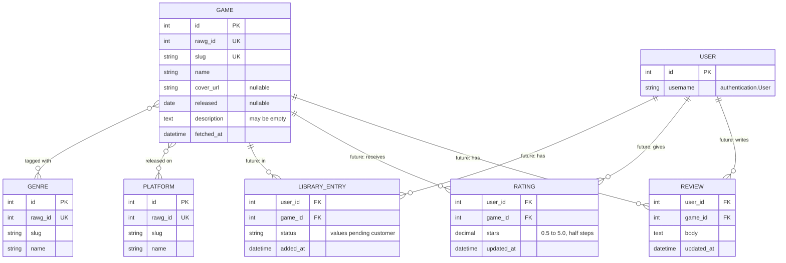
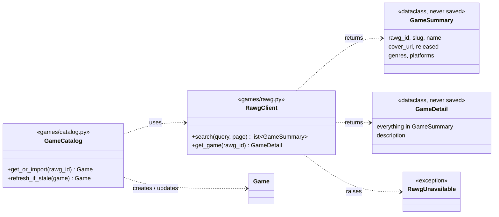
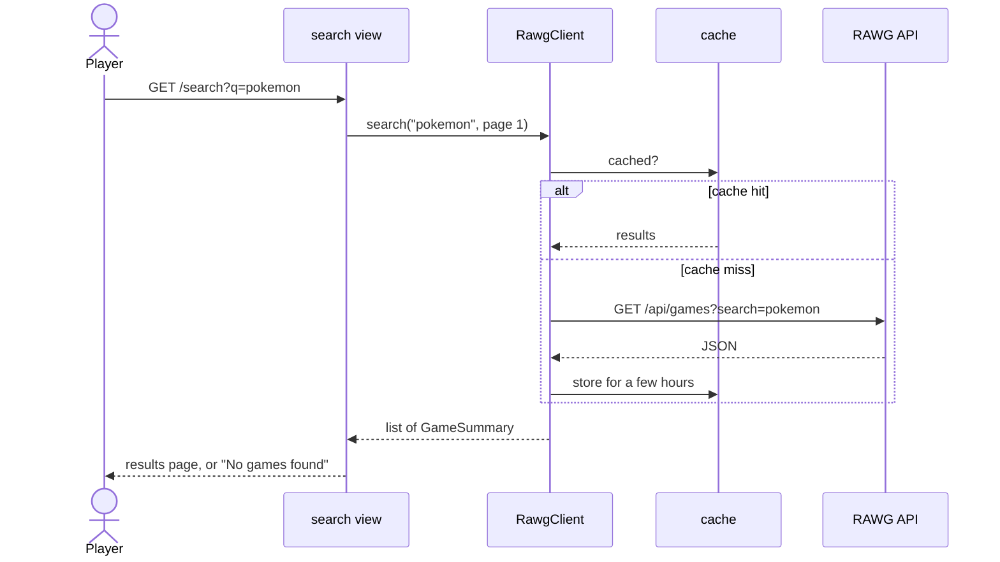
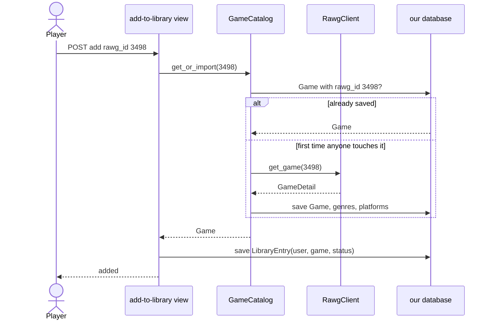

# Design: game search and the game catalog

**Status: proposal.** Nothing here is built yet. Comment on the PR. Once the team agrees, this page becomes the reference for #9 (search), #10 (details), #11 (library), #13 (rating) and #14 (reviews).

## The problem
Players search for any game by title (#9), open its details (#10), and add it to their library (#11). We don't have a list of every game, so the data comes from [RAWG](https://rawg.io/apidocs), a free video game database with an API.

RAWG's free plan has limits that shape the design:
- **20,000 requests a month** (about 650 a day).
- **No redistributing their data.** We can show it in our app, not hand it out.
- **Every page that shows RAWG data must link to RAWG.**
- **Every request needs our API key**, which must stay secret.

## Decisions
| # | Decision | Status |
| --- | --- | --- |
| 1 | Use RAWG for game data | Agreed |
| 2 | Search RAWG live; don't copy their database | Agreed |
| 3 | Cache RAWG responses for a few hours | Agreed |
| 4 | Save a game to our database only when a user does something with it (library, rating, review) | Agreed |
| 5 | Genres and platforms get their own tables | Agreed |
| 6 | Ratings and reviews are separate | Agreed |
| 7 | RAWG code is split into `RawgClient` and `GameCatalog` | Agreed |
| 8 | Library statuses, and whether users can make their own lists | **Waiting on the customer** |

### 2. Search live instead of copying RAWG
RAWG has close to a million games. Copying them would use most of a month's request quota, the copy would go out of date right away, and bulk downloads are a paid-plan feature. Instead, our server asks RAWG each time someone searches and shows the results. The browser never talks to RAWG directly, so the API key stays on our server.

### 3. Cache responses
Popular searches ("zelda", "minecraft") would otherwise ask RAWG the same thing many times a day. Django's built-in cache keeps each response for a few hours, so repeats cost nothing. We'll also search when the user submits the form, not on every keystroke.

### 4. Save games only when a user touches them
A search result is temporary: it's shown and forgotten. When a user adds a game to their library, rates it, or reviews it, we save that game in our own `Game` table. Libraries, ratings and reviews then point at our row, so they keep working even if RAWG is down. We save the cover image's URL, not the image file.

Saved games can go stale (a new platform, a cover change). Each `Game` remembers when it was last fetched (`fetched_at`), and the details page refreshes it from RAWG when it's old.

### 5. Genres and platforms get their own tables
Storing genres as a text or JSON field would be faster today, but "filter my library by genre", "what platforms do my friends play on", and the Sprint 4 recommendations ("which genres does this user rate highest") all need to query by genre. Separate tables make those simple queries instead of a rewrite later. We stop at genres and platforms: developers, tags, screenshots and the like can each be added with a small migration if we ever need them.

### 6. Ratings and reviews are separate
A rating is 0.5 to 5 stars in half-star steps. A review is written text. A user can rate without reviewing, or review without rating. Each user has at most one of each per game, and can edit both. A game's average rating is calculated from our users' ratings when needed, never stored, so it can't drift out of date. (The current `game_rating` field goes away.)

### 7. Two pieces for the RAWG code
- **`RawgClient`** (`games/rawg.py`) is the only code that talks to RAWG. It sends requests, applies the cache, and turns RAWG's JSON into simple Python objects. If RAWG is down or returns an error, it raises `RawgUnavailable`.
- **`GameCatalog`** (`games/catalog.py`) is the only code that saves RAWG data into our database: it creates or refreshes `Game` rows and their genres and platforms.

Why split them: tests replace `RawgClient` with one that returns canned answers. Then every other test, including `GameCatalog`'s saving logic, runs for real without a network connection, an API key, or using up our quota. And when RAWG changes something, only one file needs to change.

## Data model
Solid boxes are what the search and details work builds. The others (marked *future*) are here to check that the design holds up for Sprint 2 and beyond.

- `LIBRARY_ENTRY`, `RATING` and `REVIEW` are each unique per (user, game).
- `released`, `cover_url` and `description` can be empty because many RAWG games have no release date ("TBA"), no cover, or no description. The details page shows placeholders for these (#10).
- `description` is empty until someone opens the game's details page, because RAWG's search results don't include descriptions.

## Code structure

## How requests flow
**Searching** saves nothing:

If RAWG is down, `RawgClient` raises `RawgUnavailable` and the view shows an error message instead of crashing.

**Adding to the library** (Sprint 2) is the first time a game is saved:

## Testing plan
- **Behave scenarios** come straight from the user stories' acceptance criteria (#9's "Matching titles" and "No matches", #10's error and placeholder cases). Behave setup is #29.
- **Unit tests** for `RawgClient` use recorded RAWG responses saved as JSON files in the repo, so we test our parsing against RAWG's real format without calling RAWG.
- **Every other test** uses a fake `RawgClient`. CI never needs `RAWG_API_KEY`.

## Configuration
- New setting `RAWG_API_KEY`, read from `.env` like `SECRET_KEY`. Each of us gets a free key from RAWG for local development. Production's key goes in Render's environment.
- A footer on every page links to RAWG, as their terms require.

## Changes to the existing `Game` model
The current model is `game_title`, `game_description`, `game_rating`, `game_release`. It becomes the `GAME` table above:

| Now | Becomes | Why |
| --- | --- | --- |
| *(none)* | `rawg_id` (unique) | Ties our row to RAWG's game, so the same game isn't saved twice |
| *(none)* | `slug`, `cover_url`, `fetched_at` | Needed for URLs, the cover, and refreshing |
| `game_title` | `name` | Matches RAWG's naming; the `game_` prefix repeats the model name |
| `game_description` (required) | `description` (may be empty) | Many RAWG games have none |
| `game_release` (required) | `released` (may be empty) | Unreleased games have no date |
| `game_rating` | removed | Ratings come from our users (`RATING`) |

Existing `Game` rows have no RAWG ID. Since they're sample data, the migration would delete them. See the open questions.

The home page and its tests (`games/tests.py`) change to match.

## Open questions
1. **Library shape (customer):** one library per user organized by status, or also user-named lists where a game can be on several? If lists, we add `LIST` and `LIST_ITEM` tables.
2. **Statuses (customer):** "Not Started" vs "Want-to-play". Same thing, or both?
3. **Existing sample games (team):** OK to delete the current `Game` rows in the migration? Is anything in production that someone wants to keep?
4. **Who builds what (team):** search (#9) and details (#10) share `RawgClient`. One person, or split once `RawgClient` exists?
